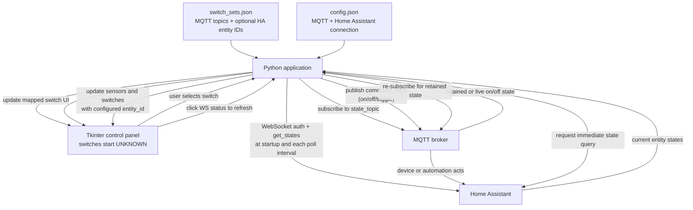

# MQTT Switch Panel

A lightweight touchscreen-friendly control panel for Home Assistant MQTT switches and door/window sensors, optimized for Raspberry Pi 7-inch displays.

## Features

- **MQTT Switch Control**: Toggle on/off switches via MQTT with configurable topics
- **Home Assistant Sensor Integration**: Display real-time door and window sensor status from Home Assistant
- **Touchscreen Optimized**: Large buttons and responsive layout for 7-inch displays
- **Responsive Layout**: Automatically wraps tiles on smaller screens
- **Live Status Display**: Real-time MQTT and WebSocket connection status
- **No Hardcoding**: Shared settings live in config.json and switches stay in switch_sets.json

## Application Architecture



At startup, switch tiles remain **UNKNOWN** until a valid state arrives from MQTT or Home Assistant. Home Assistant switch states can only be matched when the switch has an `entity_id` configured; missing IDs or unavailable/unrecognized states leave the tile UNKNOWN. MQTT states are matched by `state_topic`.

## Installation

### Prerequisites

- Python 3.11+
- pip

### Setup

1. Clone or extract this repository
2. Create a Python virtual environment:
   ```bash
   python -m venv .venv
   source .venv/bin/activate  # On Windows: .venv\Scripts\activate
   ```

3. Install dependencies:
   ```bash
   pip install -r requirements.txt
   ```

4. Configure config.json and switch_sets.json (see Configuration section below)

5. Run the app:
   ```bash
   python mqtt_switch_panel.py
   ```

## Configuration

Configuration is split across two JSON files. No code changes needed.

- switch_sets.json: add or remove MQTT switch tiles
- config.json: broker settings, Home Assistant, sensors, icons, and UI text limits

### Switches

Add switches in switch_sets.json. Each switch requires `label`, `type`, `command_topic`, and `state_topic`. Fill in the optional `entity_id` with the matching Home Assistant entity if you want Home Assistant to initialize that tile with its current state. An empty `entity_id` is ignored:

```json
[
  {
    "label": "Living Room Lamp",
    "type": "light",
    "entity_id": "light.living_room",
    "command_topic": "home/switches/livingroom/lamp/set",
    "state_topic": "home/switches/livingroom/lamp/state"
  },
  {
    "label": "Bedroom Fan",
    "type": "power",
    "command_topic": "home/switches/bedroom/fan/set",
    "state_topic": "home/switches/bedroom/fan/state"
  }
]
```

### Icons

Customize icons for switches and sensors in config.json:

```json
"icons": {
  "switch_light": "💡",
  "switch_power": "⚡",
  "sensor_door": "🚪",
  "sensor_window": "🪟"
}
```

#### Switch Types

| Type | Icon (Default) | Use Case |
|------|---|---|
| `light` | 💡 | Lights, lamps, LED strips |
| `power` | ⚡ | Power outlets, fans, pumps, appliances |

### Sensors

Display Home Assistant binary sensors for doors and windows in config.json:

```json
"sensors": [
  {
    "label": "Front Door",
    "entity_id": "binary_sensor.front_door_sensor_open",
    "kind": "door"
  },
  {
    "label": "Kitchen Window",
    "entity_id": "binary_sensor.kitchen_window_sensor_open",
    "kind": "window"
  }
]
```

#### Sensor Types

| Kind | Icon (Default) | Status |
|------|---|---|
| `door` | 🚪 | OPEN (red) / CLOSED (green) |
| `window` | 🪟 | OPEN (red) / CLOSED (green) |

### Home Assistant Integration

Configure WebSocket connection to Home Assistant for sensor updates:

```json
"home_assistant": {
  "url": "ws://192.168.68.78:8123/api/websocket",
  "access_token": "eyJhbGc...",
  "poll_interval_seconds": 10
}
```

- **url**: WebSocket URL to Home Assistant instance
- **access_token**: Long-lived access token (create in Home Assistant > Settings > Users > Create token)
- **poll_interval_seconds**: Query interval for sensor updates (minimum 5 seconds)

Sensor states and switches with a non-empty `entity_id` are queried from Home Assistant immediately at startup and then at the configured interval. Switches without an entity ID can still get their state from MQTT messages on `state_topic`; the application does not guess Home Assistant entity names. If neither source provides a valid `on` or `off` state, the switch stays UNKNOWN. Tap the `Home Assistant WS` status text at the bottom of the panel to refresh MQTT device states and Home Assistant sensor and switch states immediately.

For reliable MQTT startup status, configure the Home Assistant MQTT entity or publishing automation to retain messages on each switch `state_topic`.

Tapping a switch sends `off` when its current state is on, `on` when it is off, and `toggle` when its state is unknown. The MQTT device or automation handling `command_topic` must support the `toggle` payload.

## MQTT Broker

Configure your MQTT broker in config.json:

```json
"mqtt": {
  "broker": "192.168.68.78",
  "port": 1883,
  "keepalive": 60
}
```

## Raspberry Pi Setup

### DISPLAY setup

```bash
sudo -u homecctv DISPLAY=:0 startx
```
### xinitrc Configuration

Create/edit `~/.xinitrc` to auto-start the app:

```bash
#!/bin/sh
xset s off
xset -dpms
xset s noblank

exec /home/pi/path/to/.venv/bin/python /home/pi/path/to/mqtt_switch_panel.py
```

### Auto-start on Boot

Add to `.bashrc` or `.bash_profile`:

```bash
if [ -z "$DISPLAY" ] && [ "$(tty)" = "/dev/tty1" ]; then
    startx
fi
```

## Troubleshooting

### MQTT Connection Fails

Check the status line at bottom:
- Verify broker IP and port
- Ensure Pi and broker are on same network
- Check topic names match your MQTT setup

### Home Assistant WebSocket Shows `DISCONNECTED`

Check console output for detailed error:
- `AUTH FAILED`: Check access token is valid and not expired
- `TimeoutError`: Verify Home Assistant URL is reachable from Pi
- `Connection refused`: Check HA port (default 8123)

### Switches Not Updating

- Verify MQTT topics in switch_sets.json match your broker
- Check that switch state is published as `"on"` or `"off"`
- Ensure MQTT broker is online and accessible

## Debug Logging

Enable console logging by setting `DEBUG_LOGGING = True` in code (default is on). View logs in terminal to diagnose connection issues.

## License

MIT
